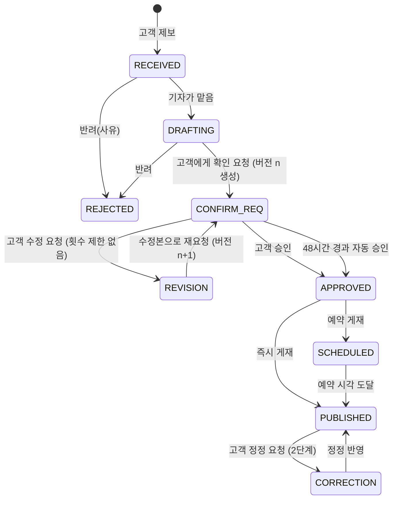

# 프레스노트 (PressNote) — 개발 명세

> 고객이 현장에서 모바일로 사진과 짧은 메모를 보내면, 편집국이 기사로 만들어 고객 확인을 받은 뒤 인터넷신문에 게재·배포하는 시스템.
> 문서 기준일: 2026-11-16 · 작성: 코어솔루션

---

## 0. 이 문서를 읽는 Claude Code에게

- 이 파일이 프로젝트의 **단일 기준 문서**다. 구현이 이 문서와 달라져야 하면 먼저 사용자에게 묻고, 결정되면 이 문서를 함께 고친다.
- **2장 "확정된 결정사항"은 바꾸지 않는다.** 6장 기술 스택은 권장안이며, 사용자가 다른 스택을 지정하면 그에 따른다.
- 작업은 **17장의 단계 순서**대로 한다. 한 단계를 끝내면 그 단계의 완료 기준을 직접 확인하고 보고한다.
- 모든 화면 문구·에러 메시지·커밋 메시지 설명은 **한국어**로 쓴다. 코드 식별자는 영어.
- 상태 전이는 반드시 서버의 한 곳(`lib/workflow.ts`)에서만 일어나게 한다. 화면이나 API 핸들러에서 `status`를 직접 바꾸지 않는다.
- 기사 본문에 들어가는 사실·숫자·인용은 **제보에 있는 것만** 쓴다. AI 초안이 지어내지 않도록 11장 규칙을 지킨다.
- 비밀 값(API 키, 알림톡 키, DB 주소)은 `.env`에만 두고 커밋하지 않는다. `.env.example`을 함께 관리한다.

---

## 1. 개요

| 항목 | 내용 |
| --- | --- |
| 서비스명 | 프레스노트 (PressNote) — 매체명이 아닌, 기자의 기사 관리 개념의 시스템 이름 |
| 목적 | 제보부터 게재까지 **당일 처리** |
| 고객 | 기업·기관 홍보 담당자(고객사 단위) **와** 지역 단체·소상공인(개인 회원) 모두 |
| 운영 주체 | 인터넷신문사 편집국 (소수 인원, 기자가 데스크 겸임) |
| 매체 성격 | IT·기술(피지컬AI 중심) 전문, 심층분석 위주. 제보형 기사는 별도 섹션(예: 현장·동정)으로 구분 검토 |

핵심 가치 세 가지:
1. **고객**: 촬영 → 메모 → 전송 3단계, 1분 안에 제보. 앱 설치 없이 모바일 웹(PWA).
2. **편집국**: 접수 즉시 AI 초안이 준비되어, 기자는 다듬기만 한다.
3. **고객 사후관리**: 게재 기사의 링크·배포 현황·처리 이력을 고객이 직접 확인.

---

## 2. 확정된 결정사항 (변경 금지)

| # | 결정 | 구현에 미치는 영향 |
| --- | --- | --- |
| D1 | **고객에게 과금하지 않는다** | 결제·이용권·정산 화면과 테이블을 만들지 않는다 |
| D2 | 고객이 기한 내 응답하지 않으면 **자동 승인** | 확인 요청 후 **48시간** 경과 시 `APPROVED`로 자동 전이 (기한 값은 설정으로) |
| D3 | 고객의 **수정 요청 횟수 제한 없음** | 버전은 계속 쌓인다. 횟수 검사 로직 없음 |
| D4 | 편집국은 **소수 인원 겸임** | 기자가 직접 검수·게재 가능. 다른 데스크 검수는 선택 옵션 |
| D5 | **AI 초안은 접수 즉시 자동 생성** | 제보 저장 직후 백그라운드 작업으로 초안 생성 |
| D6 | 고객 유형은 **고객사 + 개인 회원** 둘 다 | 고객사는 초대코드로 담당자가 합류, 개인은 단독 계정 |
| D7 | 디자인 톤은 **신뢰감 있는 뉴스 톤** | 15장 디자인 토큰 사용 (네이비 + 화이트, 명조 제목) |

---

## 3. 사용자와 권한

| 구분 | 역할 | 할 수 있는 일 |
| --- | --- | --- |
| 고객 | 제보자 | 제보 등록, 본인 기사 확인·승인·수정 요청, 본인 기사 조회 |
| 고객 | 고객사 관리자 | 제보자 권한 + 같은 고객사 전체 기사 조회, 담당자 초대(초대코드), 게재 실적 내려받기 |
| 편집국 | 기자 | 제보 맡기, 기사 작성, 확인 요청, **검수·게재(겸임)**, 반려 |
| 편집국 | 데스크 | 기자 권한 + 다른 기자 기사 검수·배정 변경 |
| 편집국 | 시스템 관리자 | 고객사·편집국 계정 관리, 설정(확인 기한, 템플릿), 통계 |

권한 규칙:
- 고객은 **자기 고객사(또는 개인 계정)의 제보만** 볼 수 있다. API에서 매 요청마다 `customerId`를 검사한다.
- 고객의 기사 확인 화면은 **로그인 없이 1회용 보안 링크**로도 열린다(알림톡 링크). 토큰은 해당 확인 요청에만 유효하고 기한이 지나면 만료된다.
- 편집국 메모(`customers.memo`)는 고객 API 응답에 절대 포함하지 않는다.

---

## 4. 업무 흐름



고객은 ①제보 ②확인(승인/수정요청) ③게재 기사 관리, 세 지점에서만 시스템을 만난다. 나머지는 편집국이 처리한다.

---

## 5. 상태값과 전이 규칙

| 코드 | 편집국 표시 | 고객 표시 | 칩 색 | 다음 상태로 넘기는 주체 |
| --- | --- | --- | --- | --- |
| `RECEIVED` | 접수 | 접수완료 | 회색 | 기자(맡기) / 기자(반려) |
| `DRAFTING` | 작성중 | 작성중 | 파랑 | 기자(확인 요청) |
| `CONFIRM_REQ` | 고객 확인 대기 | 확인요청 | 주황 | 고객(승인·수정요청) / 스케줄러(자동 승인) |
| `REVISION` | 수정 요청 도착 | 수정중 | 주황 | 기자(재요청) |
| `APPROVED` | 게재 대기 | 게재대기 | 네이비 | 기자(게재·예약) |
| `SCHEDULED` | 게재 예약 | 게재대기 | 네이비 | 스케줄러(예약 시각) |
| `PUBLISHED` | 게재 완료 | 게재완료 | 초록 | 고객(정정 요청, 2단계) |
| `CORRECTION` | 정정 처리중 | 정정중 | 주황 | 기자(정정 반영) — 2단계 |
| `REJECTED` | 반려 | 반려(사유 표시) | 빨강 | 종료 |

전이 규칙 (모두 `lib/workflow.ts`에서 검증):
- 허용되지 않은 전이는 `409 Conflict`와 한국어 메시지로 거부한다.
- 전이마다 `report_history`에 한 줄을 남긴다 (시각, 주체, 내용). 고객 화면의 "처리 이력"은 이 테이블을 그대로 보여준다.
- `CONFIRM_REQ` 진입 시: 현재 편집 내용으로 **새 `article_version`을 만들고**, `confirm_request`를 생성(기한 = 지금 + 48시간, 1회용 토큰 발급), 알림톡 발송.
- `REVISION` 진입 시: 고객의 문단별 코멘트(`revision_comment`)를 저장. 문단 번호는 **해당 버전 기준** 인덱스.
- 자동 승인 시 `confirm_request.result = 'auto'`로 기록해 통계(자동 승인 비율)에 쓴다.
- 확인 기한 연장: 편집국이 24시간 단위로 연장할 수 있다(이력 기록).
- `PUBLISHED` 진입 시 `published_at` 기록, 배포 채널별 `distribution` 행 생성, 고객에게 기사 링크 알림톡.

---

## 6. 기술 스택 (권장안)

| 영역 | 권장 | 이유 |
| --- | --- | --- |
| 프레임워크 | **Next.js 15 (App Router) + TypeScript** | 고객 모바일 웹·편집국 관리자·공개 기사 페이지를 한 저장소에서 |
| UI | Tailwind CSS + 자체 컴포넌트 | 15장 토큰을 Tailwind 테마로 |
| DB | **PostgreSQL** + Prisma | 기사 버전·이력 관계형 저장 |
| 파일 | S3 호환 오브젝트 스토리지 (NCP Object Storage, AWS S3 등) | 원본 + 리사이즈본 |
| 이미지 처리 | sharp | 업로드 시 1920px 리사이즈, EXIF(촬영 시각·위치) 추출 후 원본 메타 제거 |
| AI | Anthropic API (Claude) | 기사 초안·제목 후보, 사진 3장까지 함께 전달 |
| 백그라운드 작업 | 1단계: DB 폴링 크론(1분) / 2단계: pg-boss 또는 BullMQ | 자동 승인, 예약 게재, 재알림, AI 초안 |
| 알림 | 카카오 알림톡 발송 대행사 API (실패 시 문자 대체) | 템플릿 사전 승인 필요 |
| 고객 인증 | 휴대폰 번호 + SMS 인증번호 | 고객사는 초대코드로 소속 연결 |
| 편집국 인증 | 이메일 + 비밀번호 (Auth.js) | |
| 테스트 | Vitest(단위) + Playwright(E2E) | 17장 완료 기준을 E2E로 |

환경 변수 (`.env.example`):
```
DATABASE_URL=
S3_ENDPOINT=
S3_BUCKET=
S3_ACCESS_KEY=
S3_SECRET_KEY=
ANTHROPIC_API_KEY=
ANTHROPIC_MODEL=            # 예: 사용 가능한 Claude 모델 ID
ALIMTALK_API_KEY=
ALIMTALK_SENDER_KEY=
SMS_API_KEY=
SMS_SENDER_NUMBER=
APP_BASE_URL=
AUTH_SECRET=
CONFIRM_DEADLINE_HOURS=48
CONFIRM_REMIND_AFTER_HOURS=24
```

---

## 7. 디렉터리 구조

```
pressnote/
├─ CLAUDE.md                 # 이 문서
├─ prisma/schema.prisma
├─ src/
│  ├─ app/
│  │  ├─ (customer)/m/...    # 고객 모바일 웹  (M01~M09)
│  │  ├─ (desk)/desk/...     # 편집국 관리자   (A01~A07)
│  │  ├─ (public)/news/[no]  # 공개 기사 페이지 (P01)
│  │  ├─ c/[token]           # 로그인 없는 확인 링크 → M05
│  │  └─ api/...
│  ├─ lib/
│  │  ├─ workflow.ts         # 상태 전이 (유일한 status 변경 지점)
│  │  ├─ ai-draft.ts         # AI 초안 생성
│  │  ├─ notify.ts           # 알림톡/문자/편집국 알림
│  │  ├─ media.ts            # 업로드·리사이즈·EXIF
│  │  ├─ numbering.ts        # 접수번호 PN-YYYYMMDD-NNNN
│  │  └─ auth/...
│  ├─ jobs/                  # 자동 승인, 예약 게재, 재알림, AI 초안
│  └─ components/
└─ tests/
```

---

## 8. 데이터 모델

```prisma
enum CustomerKind { ORG PERSON }
enum CustomerRole { REPORTER ORG_ADMIN }
enum StaffRole { EDITOR DESK ADMIN }
enum ReportStatus { RECEIVED DRAFTING CONFIRM_REQ REVISION APPROVED SCHEDULED PUBLISHED CORRECTION REJECTED }
enum ConfirmResult { APPROVED REVISION AUTO }
enum Channel { HOMEPAGE FACEBOOK BLOG PORTAL }

model Customer {            // 고객사 또는 개인 회원
  id         String   @id @default(cuid())
  kind       CustomerKind
  name       String
  inviteCode String?  @unique        // ORG만. 예: HB-7K2Q, 재발급 가능
  memo       String?                 // 편집국 전용 메모 (고객에게 비공개)
  createdAt  DateTime @default(now())
  users      CustomerUser[]
  reports    Report[]
}

model CustomerUser {        // 제보자
  id         String   @id @default(cuid())
  customerId String
  customer   Customer @relation(fields: [customerId], references: [id])
  name       String
  phone      String   @unique
  role       CustomerRole @default(REPORTER)
  department String?
  createdAt  DateTime @default(now())
}

model StaffUser {           // 편집국
  id        String   @id @default(cuid())
  name      String
  email     String   @unique
  password  String
  role      StaffRole @default(EDITOR)
  categories String[]         // 담당 분야 (자동 배정용, 2단계)
}

model Report {              // 제보 1건 = 기사 1건
  id           String   @id @default(cuid())
  no           String   @unique         // PN-20261029-0142
  customerId   String
  reporterId   String                   // CustomerUser
  title        String?                  // 행사·소식 제목
  category     String                   // 피지컬AI | 레저산업 | 브랜딩·마케팅 | 의료 | 지역·동정 | 기타
  eventAt      String?                  // 고객 입력 그대로 (예: "10.29 19:00")
  place        String?
  memo         String?
  desiredDate  String                   // 가능한 빨리(당일) | 내일 | 이번 주 안 | 날짜 협의
  consent      Boolean                  // 사진 권리·인물 동의 (필수 true)
  status       ReportStatus @default(RECEIVED)
  ownerId      String?                  // StaffUser
  rejectReason String?
  section      String?                  // 게재 섹션
  createdAt    DateTime @default(now())
  assignedAt   DateTime?
  approvedAt   DateTime?
  scheduledAt  DateTime?
  publishedAt  DateTime?
  updatedAt    DateTime @updatedAt
  media        ReportMedia[]
  draft        ArticleDraft?
  versions     ArticleVersion[]
  confirms     ConfirmRequest[]
  history      ReportHistory[]
  distributions Distribution[]
}

model ReportMedia {
  id         String  @id @default(cuid())
  reportId   String
  kind       String              // PHOTO | ATTACHMENT(PDF·한글·워드)
  originalKey String
  displayKey  String?            // 1920px 리사이즈본
  thumbKey    String?            // 400px
  takenAt    DateTime?           // EXIF
  lat        Float?
  lng        Float?
  isCover    Boolean @default(false)
  sort       Int
  addedBy    String              // CUSTOMER | STAFF
}

model ArticleDraft {        // 편집 중인 원고 (자동 저장)
  reportId     String  @id
  titleCandidates String[]     // AI 제목 후보 3개
  title        String
  subtitle     String?
  caption      String?
  body         String          // 문단 사이는 빈 줄
  tags         String[]
  aiChecks     String[]        // AI가 표시한 "확인 필요" 항목
  checklist    Json            // {photo:bool, fact:bool, ad:bool}
  aiGeneratedAt DateTime?
  savedAt      DateTime @updatedAt
}

model ArticleVersion {      // 고객에게 보낸 원고 스냅숏 (불변)
  id         String  @id @default(cuid())
  reportId   String
  version    Int                 // 1, 2, 3 ...
  title      String
  subtitle   String?
  caption    String?
  paragraphs String[]
  createdBy  String              // StaffUser
  createdAt  DateTime @default(now())
  @@unique([reportId, version])
}

model ConfirmRequest {
  id          String   @id @default(cuid())
  reportId    String
  version     Int
  token       String   @unique    // 1회용 링크 토큰 (해시 저장 권장)
  requestedAt DateTime @default(now())
  deadline    DateTime
  remindedAt  DateTime?
  result      ConfirmResult?
  respondedAt DateTime?
  respondedBy String?             // CustomerUser, AUTO면 null
  generalNote String?
  comments    RevisionComment[]
}

model RevisionComment {
  id         String @id @default(cuid())
  confirmId  String
  paragraph  Int                  // 해당 버전 paragraphs 인덱스, -1 = 전체 의견
  text       String
  resolved   Boolean @default(false)   // 기자가 "반영함" 표시
}

model ReportHistory {
  id        String   @id @default(cuid())
  reportId  String
  at        DateTime @default(now())
  actorType String               // CUSTOMER | STAFF | SYSTEM
  actorId   String?
  text      String               // "고객 확인 요청 (2차 원고)" 등 화면 표시 문구
}

model Distribution {
  id        String  @id @default(cuid())
  reportId  String
  channel   Channel
  status    String               // PENDING | DONE | FAILED
  url       String?
  views     Int     @default(0)
}

model NotificationLog {
  id        String   @id @default(cuid())
  event     String
  toType    String               // CUSTOMER | STAFF
  toId      String
  channel   String               // ALIMTALK | SMS | WEB_PUSH | IN_APP
  result    String
  createdAt DateTime @default(now())
}

model Setting {             // 확인 기한, 재알림 시점 등
  key   String @id
  value String
}
```

접수번호: `PN-` + 접수일(YYYYMMDD) + `-` + 그날 순번 4자리. 동시 접수에도 겹치지 않게 DB 시퀀스 또는 트랜잭션으로 발급.

---

## 9. API

모든 응답은 JSON, 에러는 `{ error: { code, message } }` (message는 한국어, 사용자에게 그대로 보여줄 수 있는 문장).

### 고객
| 메서드 | 경로 | 설명 |
| --- | --- | --- |
| POST | `/api/auth/otp` | 휴대폰 인증번호 발송 |
| POST | `/api/auth/verify` | 인증 + (신규면) 가입. 고객사는 `inviteCode` 함께 |
| GET | `/api/me` | 내 정보, 소속 고객사 |
| POST | `/api/media` | 사진·첨부 업로드 (multipart) → `mediaId` |
| POST | `/api/reports` | 제보 등록 → 접수번호. 저장 후 AI 초안 작업 등록 |
| GET | `/api/reports?status=` | 내(고객사 관리자는 고객사 전체) 기사 목록 |
| GET | `/api/reports/:id` | 상세 + 처리 이력 + 최신 버전 |
| GET | `/api/confirm/:token` | 로그인 없이 확인 화면 데이터 (최신 버전, 이전 버전과의 변경 문단) |
| POST | `/api/confirm/:token/approve` | 승인 |
| POST | `/api/confirm/:token/revise` | 수정 요청 `{ comments:[{paragraph,text}], generalNote, mediaIds }` |
| GET | `/api/org/summary` | 고객사 관리자: 월별 게재 건수, 담당자별 제보 수, 초대코드 |
| GET | `/api/org/report.xlsx` | 게재 실적 내려받기 (2단계) |

### 편집국 (`/api/desk/*`, 편집국 세션 필수)
| 메서드 | 경로 | 설명 |
| --- | --- | --- |
| GET | `/desk/reports?status=&owner=` | 목록 (접수함·현황 보드 공용) |
| POST | `/desk/reports/:id/take` | 맡기 → `DRAFTING` |
| POST | `/desk/reports/:id/reject` | 반려 `{reason}` |
| GET/PUT | `/desk/reports/:id/draft` | 원고 불러오기/자동 저장 |
| POST | `/desk/reports/:id/ai-draft` | AI 초안 다시 만들기 |
| POST | `/desk/reports/:id/request-confirm` | 버전 생성 + 확인 요청 → `CONFIRM_REQ` |
| POST | `/desk/reports/:id/extend` | 확인 기한 24시간 연장 |
| POST | `/desk/reports/:id/publish` | `{mode:'now'|'at', at?, section, channels[]}` → `PUBLISHED` 또는 `SCHEDULED` |
| GET | `/desk/reports/:id/diff?from=&to=` | 버전 비교 |
| GET/POST/PATCH | `/desk/customers` | 고객 목록·등록(초대코드 발급)·메모 |
| POST | `/desk/customers/:id/invite-code` | 초대코드 재발급 (이전 코드 무효) |
| GET | `/desk/stats?from=&to=` | 통계 |

### 공개
| 메서드 | 경로 | 설명 |
| --- | --- | --- |
| GET | `/news/:no` | 게재 기사 페이지 (SSR, OG 태그 포함) |

---

## 10. 화면 명세

화면 ID는 디자인 시안·프로토타입과 같다. 기준 시안 링크는 19장.

### 고객 모바일 웹 (폭 기준 390px, 하단 탭: 홈 · 제보하기 · 내 기사 · 고객사/내 정보)

**M01 로그인**
- 탭: 고객사 담당자 / 개인 회원. 휴대폰 번호 → 인증번호(3분) → 로그인.
- 고객사 담당자 첫 가입 시 초대코드 입력 → 해당 고객사에 연결.
- 이용약관·개인정보 처리방침 동의 안내.

**M02 홈**
- 인사말("○○ 님, 오늘 현장 소식을 보내주세요"), 소속명.
- 큰 버튼 "새 기사 제보하기".
- 확인 요청 카드(있을 때만): 제목 + 남은 시간 → M05.
- 상태 요약 3칸: 진행중 / 확인요청 / 게재완료.
- 최근 기사 4건 (썸네일, 제목, 날짜, 상태 칩).

**M03 기사 제보**
- 사진: 촬영·선택(여러 장), 첫 장이 대표, 빼기 가능. 업로드 전 기기에서 1920px로 줄여 전송. 촬영 시각·위치 자동 첨부 안내.
- 분야 칩 6개 (피지컬AI / 레저산업 / 브랜딩·마케팅 / 의료 / 지역·동정 / 기타).
- 행사·소식 제목, 일시, 장소, 내용 메모(음성 입력 안내), 참고 파일(PDF·한글·워드, 선택), 희망 게재일.
- 사진 권리·인물 동의 체크(필수).
- 검증: 제목 또는 메모 중 하나 필수, 사진 1장 이상, 동의 필수. 에러는 버튼 위에 한 줄.
- 통신 불량 대비: 입력 중 내용은 기기에 임시 저장, 전송 실패 시 다시 보내기.

**M04 접수 완료**
- 접수번호, 진행 단계 4개(접수 → 작성 → 고객 확인 → 게재), "48시간 안에 응답이 없으면 자동 승인" 안내.
- 버튼: 내 기사에서 진행 보기 / 다른 소식 이어서 제보 / 홈.

**M05 기사 확인 (컨펌)** — 로그인 없이 `/c/[token]`으로도 진입
- 상단 경고 띠: "MM.DD HH:mm까지 확인해 주세요 · n시간 남음 / 기한까지 응답이 없으면 자동 승인되어 게재됩니다".
- n차 원고 · 담당 기자, "바뀐 부분 표시" 토글(이전 버전 대비 바뀐 문단 노란 배경).
- 실제 게재 화면과 같은 형태로 미리보기 (분야, 명조 제목, 부제, 바이라인, 대표사진+설명, 본문).
- `[확인 필요: …]` 표시는 주황 배지로 강조.
- 하단 고정: 수정 요청 / 승인하기.

**M06 수정 요청**
- 문단을 누르면 펼쳐지며 의견 입력. 의견 단 문단엔 "의견" 배지.
- 전체 의견(선택), 대표사진 바꾸기·사진 추가.
- "횟수 제한 없이 요청할 수 있습니다" 안내. 의견 0개면 보내기 막고 안내.

**M07 내 기사**
- 필터 탭: 전체 / 진행중 / 확인요청 / 게재완료 / 반려.
- 카드: 썸네일, 날짜, 상태 칩, 제목 2줄, 부가정보(확인 기한, 담당 기자, 조회수, 반려 사유).

**M08 게재 기사 상세**
- 대표사진, 제목, 게재 일시·기자, 기사 URL 복사, 카카오톡 공유, 기사 보기.
- 반응(조회수, 공유수 — 2단계), 배포 채널별 상태, 처리 이력, 정정·삭제 요청(2단계).
- 진행 중인 기사는 같은 경로에서 진행 단계 + 제보 원본 + 처리 이력을 보여준다.

**M09 고객사 관리** (고객사 관리자)
- 이번 달 제보·게재·진행중, 최근 4개월 월별 게재 막대.
- 담당자 목록(부서, 이번 달 제보 수), 담당자 초대, 초대코드 복사.
- 게재 실적 보고서 내려받기(엑셀·PDF, 2단계). **과금·이용권 표시 없음 (D1).**

### 편집국 관리자 (PC 기준 1440px, 좌측 네이비 사이드바)

사이드바: 접수함 · 기사 작성 · 컨펌 관리 · 검수·게재 · 기사 현황 · 고객 관리 · 통계. 앞의 4개는 처리 대기 건수 배지(접수함은 주황 강조). 하단에 로그인한 기자 이름 + "기자 · 데스크 겸임".

**A01 접수함**
- 요약: 새 제보 / 오늘 게재 희망 / 작성중 / 최근 7일 평균 접수→게재.
- 표: 접수번호, 제목, 고객, 분야, 희망 게재, 경과(2시간 넘으면 빨강), 담당. 필터 탭: 전체 / 미배정 / 내 담당 / 긴급.
- 우측 상세: 사진, 고객·연락처·일시·장소, 메모, "AI 초안 준비됨" 표시, 담당 기자 선택, **맡고 기사 작성** / **반려**(사유 선택: 광고성 / 사실 확인 불가 / 정보 부족 / 이미 보도됨).
- 새 제보 도착 시 화면 알림.

**A02 기사 작성**
- 좌: 제보 원본(사진, 일시·장소·분야, 고객 메모, 첨부 파일, 고객 수정 요청 내용), 게재 전 확인 체크(사진 권리 / 수치·이름 사실 확인 / 광고성 표현 없음).
- 우: 툴바(템플릿, AI 초안 다시 만들기, 맞춤법 검사, 사진 편집·모자이크), AI 제목 후보 3개(라디오 선택 → 제목 칸에 들어감), 제목, 부제, 대표사진 설명, 본문(문단은 빈 줄), AI가 표시한 확인 사항, 태그.
- 자동 저장(입력 멈추고 2초 후), "HH:mm 저장됨".
- 버튼: 게재 화면 미리보기 / **고객에게 확인 요청**(재요청이면 "수정본으로 다시 확인 요청").
- 기사 템플릿: 신기술·도입 / 행사 / 협약(MOU) / 수상 / 인사·동정.

**A03 컨펌 관리**
- 좌: 목록(수정 요청 도착이 위, 그다음 확인 대기를 기한 임박순). 기한 6시간 미만은 빨강.
- 우(수정 요청): 고객 의견을 해당 문단과 함께 표시, 의견별 "반영함" 체크, **에디터에서 반영하기**.
- 우(확인 대기): 기한·남은 시간, **기한 24시간 연장**, 이전 버전과 비교(삭제 빨강 취소선 / 추가 초록).

**A04 검수·게재**
- 대상: `APPROVED`(고객 승인 / 자동 승인 구분 표시), `SCHEDULED`.
- 좌: 홈페이지 게재 화면 미리보기(PC·모바일 전환).
- 우: 검수(직접 검수 / 다른 데스크에게 요청), 게재 시점(바로 / 예약 일시), 노출 섹션, 메인 주요 기사 노출, 배포 채널(홈페이지 기본, 페이스북, 블로그, 포털은 제휴 후 비활성), "게재되면 고객에게 기사 링크가 알림톡으로 발송됩니다".
- 검수 완료 체크 전에는 게재 버튼 비활성.

**A05 기사 현황**
- 칸반 5열: 접수 / 작성중·수정 / 고객 확인 / 게재 대기 / 게재 완료(최근 12건). 카드 클릭 시 해당 처리 화면으로.
- 지연 표시(빨강): 접수 2시간 초과, 작성 6시간 초과, 확인 기한 6시간 미만.
- 담당 필터, 보드/목록 전환.

**A06 고객 관리**
- 고객사 등록(이름 → 초대코드 자동 발급), 목록(고객명, 구분, 초대코드, 이번 달 제보, 누적 게재, 최근 제보), 전체/고객사/개인 탭, 검색.
- 상세: 이번 달·누적 게재·반려, 담당자 목록, 초대코드 복사·재발급, 편집국 메모(고객 비공개).

**A07 통계** — 저장된 기록에서 계산
- 기간: 이번 달 / 지난 달 / 최근 3개월 / 직접 지정. 엑셀 내려받기.
- 지표: 접수, 게재, 평균 접수→게재 시간, 자동 승인 비율, 반려율.
- 단계별 평균 소요시간(접수→배정 / 작성 / 고객 확인 / 게재 대기) — 주별 누적 막대로 "어느 단계가 가장 오래 걸리는지".
- 분야별 게재 건수, 기자별 처리 실적(맡은 제보, 게재, 평균 작성 시간, 고객 수정 요청 평균 횟수).

### 공개 기사

**P01 기사 페이지** `/news/[no]`
- 분야, 명조 제목, 부제, 바이라인(기자·게재 일시), 대표사진+설명, 본문, 추가 사진, 태그, 저작권 문구.
- OG 메타(제목·부제·대표사진)로 카카오톡 공유 미리보기 지원.
- 고객 비용으로 게재되는 기사가 아니므로(D1) 광고 표기는 두지 않되, 18장 법률 검토 결과에 따른다.

---

## 11. AI 기사 초안

- **트리거**: 제보 저장 직후 작업 큐에 등록(D5). 실패해도 제보 접수는 성공 처리하고, 편집국에서 "AI 초안 다시 만들기"로 재시도.
- **입력**: 고객사명, 제보자, 분야, 제목, 일시, 장소, 메모(최대 3,000자), 첨부 보도자료 텍스트(추출 가능하면 앞 4,000자), 사진 최대 3장(리사이즈본).
- **출력(JSON)**:
```json
{
  "titles": ["제목 후보 3개, 각 35자 이내"],
  "subtitle": "부제 한 줄",
  "paragraphs": ["문단", "..."],
  "caption": "대표사진 설명 한 문장, 끝에 '사진=제공처'",
  "tags": ["태그 3~5개"],
  "checks": ["게재 전에 고객에게 확인할 점"]
}
```
- **프롬프트 규칙** (프로토타입에서 검증한 문구):
  - 너는 한국 인터넷신문 '프레스노트'의 기자다. 아래 고객 제보로 보도 기사 초안을 쓴다.
  - 제보에 없는 사실, 숫자, 인용문, 사람 이름, 직함을 **지어내지 않는다**. 필요하지만 없는 정보는 본문에 `[확인 필요: 무엇]`으로 남긴다.
  - 스트레이트 기사체(~했다, ~밝혔다). 첫 문단에 누가·언제·어디서·무엇을.
  - 근거 없는 홍보성 수식(최고, 최초, 획기적 등)을 쓰지 않는다.
  - 본문 3~6문단, 문단마다 1~3문장.
  - JSON 하나만 답한다.
- 응답 검증: JSON 파싱 실패, `paragraphs` 비어 있음 → 실패 처리(재시도 1회 후 편집국에 "직접 작성" 안내).
- 결과는 `ArticleDraft`에 저장하고 `aiGeneratedAt` 기록. 기자가 이미 편집을 시작한 원고는 자동으로 덮어쓰지 않는다(다시 만들기는 확인 후 덮어씀).
- 모델 ID·최대 토큰은 환경 변수로.

---

## 12. 알림

| 이벤트 | 받는 사람 | 채널 | 내용 |
| --- | --- | --- | --- |
| 제보 접수 | 고객 / 편집국 | 알림톡 / 화면 알림 | 접수번호, 진행 안내 / 신규 제보 |
| 기자 배정 | 기자 | 화면 알림 | 배정 제보, 희망 게재일 |
| 확인 요청 | 고객 | 알림톡 | 확인 링크(1회용), 기한 |
| 확인 재알림 | 고객 | 알림톡 | 요청 후 24시간 미응답 시 1회, "기한 후 자동 승인" 안내 |
| 수정 요청 도착 | 담당 기자 | 화면 알림 | 의견 수 |
| 고객 승인 / 자동 승인 | 담당 기자 | 화면 알림 | 게재 대기 |
| 게재 완료 | 고객 | 알림톡 | 기사 URL, 공유 버튼 |
| 반려 | 고객 | 알림톡 | 반려 사유 |

- 알림톡 실패 시 같은 내용을 문자로 대체 발송. 모든 발송은 `NotificationLog`에 남긴다.
- 알림톡 템플릿 7종은 대행사를 통해 **사전 승인**이 필요하다. 승인 전에는 문자로만 발송하도록 설정 플래그를 둔다.
- 개발 환경에서는 실제 발송 대신 콘솔/로그 출력(`NOTIFY_DRY_RUN=true`).

---

## 13. 사진·파일 처리

- 허용: JPG, PNG, WEBP, HEIC(서버에서 JPG 변환) / 첨부: PDF, HWP, HWPX, DOCX. 파일당 20MB.
- 업로드 시: EXIF에서 촬영 시각·위치 추출 → DB 저장 → **원본 메타 제거본**을 원본으로 보관, 1920px 표시본, 400px 썸네일 생성.
- 공개 기사·고객 화면에는 위치 정보를 노출하지 않는다(편집국 참고용).
- 사진 편집(2단계): 자르기, 회전, 얼굴·번호판 모자이크. 편집본은 새 파일로 저장하고 원본 유지.

---

## 14. 스케줄러 (1분마다)

1. `CONFIRM_REQ`이고 `deadline < now` → `APPROVED`, `result = AUTO`, 이력 "확인 기한(48시간) 경과 — 자동 승인", 담당 기자 알림.
2. `CONFIRM_REQ`이고 `requestedAt + 24h < now`이고 `remindedAt` 없음 → 재알림 1회.
3. `SCHEDULED`이고 `scheduledAt <= now` → `PUBLISHED`, 배포 처리, 고객 알림.
4. AI 초안 대기 작업 처리.

모든 작업은 **멱등**이어야 한다(같은 건을 두 번 처리해도 결과가 같게, 전이 전에 현재 상태 재확인).

---

## 15. 디자인 가이드 (신뢰감 있는 뉴스 톤)

색상 토큰 (라이트 / 다크):
| 토큰 | 라이트 | 다크 | 용도 |
| --- | --- | --- | --- |
| `--bg` | #F3F5F8 | #0D131C | 페이지 바탕 |
| `--surface` | #FFFFFF | #151D29 | 카드 |
| `--ink` | #152033 | #E6EBF2 | 본문 글자 |
| `--muted` | #566173 | #9BA7B7 | 보조 글자 |
| `--line` | #DCE1E8 | #2A3546 | 테두리 |
| `--primary` | #0F2A4A | #9DBDF0 | 주 버튼, 사이드바, 로고 |
| `--warn` / `--warn-bg` | #8A4300 / #FDF1E3 | #F2B36B / #3A2A12 | 확인요청, 수정요청 |
| `--ok` / `--ok-bg` | #17663F / #E5F3EB | #73D39E / #12301F | 게재완료 |
| `--info` / `--info-bg` | #1C4F9C / #E8EFFA | #93BBF2 / #172A45 | 작성중 |
| `--bad` / `--bad-bg` | #A61B1B / #FBEAEA | #F29191 / #3A1717 | 반려, 지연 |

- 글꼴: 본문·UI **Noto Sans KR**, 기사 제목·본문 미리보기 **Noto Serif KR**.
- 로고: 네이비 사각형(모서리 7~12px) 안에 명조 "P".
- 고객 화면: 터치 영역 최소 44px, 주요 버튼 높이 52px, 하단 고정 버튼 바.
- 상태는 색만이 아니라 칩 문구로도 구분. 숫자는 `tabular-nums`.
- 이모지 사용 금지, 아이콘은 선 아이콘.

---

## 16. 보안·개인정보

- 고객 데이터 접근은 서버에서 소속 검사(다른 고객사 기사 조회 불가). E2E 테스트로 확인.
- 확인 링크 토큰: 32바이트 이상 무작위, DB에는 해시로 저장, 기한 지나거나 응답하면 만료.
- 휴대폰 번호·이름은 개인정보 — 편집국 화면에서는 일부 가림(010-****-1234), 로그에 원문 금지.
- 사진의 저작권·초상권 동의를 접수 시 필수로 받고, 동의 문구 버전을 저장.
- 파일 URL은 서명된 단기 URL로 제공(공개 기사 사진 제외).

---

## 17. 개발 단계와 완료 기준

### 1단계 — MVP: 한 바퀴가 돈다
범위: M01~M08(조회수 제외), A01~A06, P01, AI 초안, 자동 승인·예약 게재 스케줄러, 알림(문자 또는 DRY_RUN).

완료 기준 (Playwright E2E로 확인):
- [ ] 고객사 등록 → 초대코드로 담당자 가입 → 사진 2장과 메모로 제보 → 접수번호 발급
- [ ] 편집국 접수함에 즉시 표시, AI 초안(제목 후보 3개 + 본문)이 준비됨
- [ ] 기자가 맡고 수정 → 확인 요청 → 고객 화면에 기한과 함께 표시
- [ ] 고객이 문단 2곳에 의견 달아 수정 요청 → 편집국에서 의견이 해당 문단과 함께 보임
- [ ] 2차 원고로 재요청 → 고객 화면에서 바뀐 문단 강조 → 승인
- [ ] 검수 체크 후 즉시 게재 → `/news/[no]` 공개, 고객 화면에 링크
- [ ] 확인 기한을 과거로 바꾸면 스케줄러가 자동 승인 처리하고 이력에 남김
- [ ] 예약 게재가 예약 시각에 게재됨
- [ ] 다른 고객사 계정으로 남의 기사 URL 접근 시 거부
- [ ] 모든 상태 전이가 `report_history`에 기록됨

### 2단계 — 제작 속도
기사 템플릿, 사진 편집·모자이크, 맞춤법 검사, 버전 비교 고도화, M09 고객사 관리·실적 내려받기, A07 통계, 조회수 집계, 알림톡 정식 연동, 정정 요청(`CORRECTION`), 분야별 자동 배정.

### 3단계 — 배포 확대
SNS(페이스북·블로그) 자동 게시, 포털 뉴스 제휴 송고, 필요 시 네이티브 앱, 다른 데스크 검수 워크플로.

---

## 18. 미결정 사항 (구현 전 사용자에게 확인)

- [ ] **광고 표기**: 고객 제보 기사에 "보도자료 제공" 등 표기 필요 여부 — 법률 검토
- [ ] **편집 책임·반려 기준**: 사실 확인 기준과 반려 사유 목록 확정
- [ ] **사진 보관 기간**과 동의 문구 최종안
- [ ] **CMS**: 신문사 홈페이지를 이 시스템과 함께 만들지, 기존 언론사 CMS와 연동할지 (1단계는 P01 자체 페이지로 진행)
- [ ] **포털 배포**: 초기 채널을 자사 홈페이지·SNS로 한정할지
- [ ] **매체 성격과의 조화**: 제보형 기사를 별도 섹션(예: 현장·동정)으로 둘지
- [ ] **고객 로그인**: 휴대폰 인증 외 카카오 로그인 추가 여부
- [ ] **알림톡 대행사** 선정과 발신 프로필
- [ ] **호스팅**: 클라우드 사업자(NCP / AWS 등)와 도메인

---

## 19. 참고 자료

| 자료 | 내용 | 링크 |
| --- | --- | --- |
| 시스템 설계서 | 개요, 역할, 흐름, 상태값, 데이터 모델, 알림, 단계 계획 | https://claude.ai/artifact/6VF96p6yRrPzTHSMMpcZ4G |
| 화면 디자인 시안 | M01~M09, A01~A07 화면 17개 (디자인 캔버스) | https://claude.ai/artifact/5Dzt1gYyDd5idoLpCnpa9f |
| 작동 프로토타입 | 제보→AI 초안→확인→게재 흐름이 실제로 동작하는 웹앱 (화면·문구·AI 프롬프트 기준) | https://claude.ai/artifact/2qgyFaARbTQZPE5Cdkheoa |

위 링크는 claude.ai 로그인이 필요하다. Claude Code에서 직접 열 수 없으면 사용자에게 화면 캡처나 HTML 파일을 요청한다. 화면 구성·문구가 이 문서와 다르면 **이 문서가 우선**이다.
